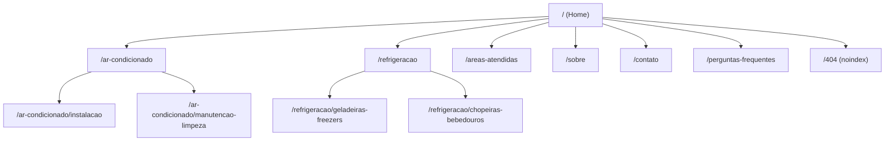

# Arquitetura de Informação e Estrutura de URLs

> Versão: 1.0 (2026-11-06)  
> Framework: Angular 19 SSR / Prerender (`@angular/ssr`)  
> Diretriz: URLs Amigáveis, Kebab-Case, Sem Fragmentos (#) para Indexação

---

## 1. Princípios da Nova Arquitetura
1. **Roteamento Real com `<router-outlet>`:** Extinção do modelo atual de One-Page empilhada com `*ngIf="!isLoading"`. Cada rota representa um documento HTML completo e independente gerado no build (`prerender`).
2. **URLs Semânticas e Limpas:** Estrutura estritamente em minúsculas, palavras separadas por hífen, refletindo a hierarquia lógica dos serviços.
3. **Canonicalização Absoluta:** Toda página possui tag canônica com URL absoluta apontando para si mesma (`https://alvesrefrigeracao.com.br/...`).
4. **Hierarquia de Headings Estrita:** Exatamente um `<h1>` por página, seguido de `<h2>` para seções temáticas e `<h3>` para blocos/cards específicos.
5. **Cross-Linking Contextual:** Links internos entre serviços complementares e áreas geográficas atendidas, facilitando a navegação do usuário e a distribuição de PageRank interno pelo Googlebot.

---

## 2. Árvore do Site e Mapa de Rotas



---

## 3. Especificação Detalhada por Rota

| Rota (Path) | Componente Angular | Finalidade Primária | Canonical URL | Title Tag (≤ 60 chars) |
| :--- | :--- | :--- | :--- | :--- |
| `/` | `HomeComponent` | Hub principal, proposta de valor, atalhos de serviços e prova social | `https://alvesrefrigeracao.com.br/` | Alves Refrigeração \| Climatização em Nova Lima MG |
| `/ar-condicionado` | `ArCondicionadoHubComponent` | Visão geral de climatização, marcas atendidas e diferenciais | `https://alvesrefrigeracao.com.br/ar-condicionado` | Ar-Condicionado em Nova Lima \| Alves Refrigeração |
| `/ar-condicionado/instalacao` | `ArCondicionadoInstalacaoComponent` | Instalação técnica residencial e comercial | `https://alvesrefrigeracao.com.br/ar-condicionado/instalacao` | Instalação de Ar-Condicionado em Nova Lima \| Orçamento |
| `/ar-condicionado/manutencao-limpeza` | `ArCondicionadoManutencaoComponent` | Manutenção preventiva/corretiva, recarga de gás e higienização | `https://alvesrefrigeracao.com.br/ar-condicionado/manutencao-limpeza` | Manutenção de Ar-Condicionado em Nova Lima \| Limpeza e Gás |
| `/refrigeracao` | `RefrigeracaoHubComponent` | Hub de refrigeração doméstica e comercial | `https://alvesrefrigeracao.com.br/refrigeracao` | Conserto de Refrigeração em Nova Lima \| Alves Refrigeração |
| `/refrigeracao/geladeiras-freezers` | `GeladeirasFreezersComponent` | Reparo urgente de geladeiras, frost-free e freezers | `https://alvesrefrigeracao.com.br/refrigeracao/geladeiras-freezers` | Conserto de Geladeira em Nova Lima \| Reparo Rápido |
| `/refrigeracao/chopeiras-bebedouros` | `ChopeirasBebedourosComponent` | Manutenção técnica para bares, restaurantes e empresas | `https://alvesrefrigeracao.com.br/refrigeracao/chopeiras-bebedouros` | Manutenção de Chopeiras e Bebedouros em Nova Lima \| Reparo |
| `/areas-atendidas` | `AreasAtendidasComponent` | Detalhamento de cobertura em Nova Lima, condomínios e Grande BH | `https://alvesrefrigeracao.com.br/areas-atendidas` | Regiões Atendidas em Nova Lima e Grande BH \| Alves |
| `/sobre` | `SobreComponent` | História, qualificações técnicas, compromisso ético e garantia | `https://alvesrefrigeracao.com.br/sobre` | Sobre a Alves Refrigeração \| Assistência em Nova Lima |
| `/contato` | `ContatoComponent` | Telefone, WhatsApp, endereço físico e mapa de localização | `https://alvesrefrigeracao.com.br/contato` | Contato e Orçamento \| Alves Refrigeração Nova Lima |
| `/perguntas-frequentes` | `FaqComponent` | Respostas a dúvidas comuns de clientes (preço, garantia, tempo) | `https://alvesrefrigeracao.com.br/perguntas-frequentes` | Perguntas Frequentes sobre Climatização \| Alves |
| `**` (404) | `NotFoundComponent` | Página de erro amigável com orientação para voltar à home | N/A (Possui meta `robots: noindex, follow`) | Página Não Encontrada \| Alves Refrigeração |

---

## 4. Estrutura do Layout Mestre (`app.component.html`)

O layout global passa a ser enxuto e livre de amarras de carregamento assíncrono:

```html
<!-- Componente global de navegação -->
<app-navbar></app-navbar>

<!-- Ponto de injeção dinâmico das páginas pré-renderizadas -->
<main id="main-content">
  <router-outlet></router-outlet>
</main>

<!-- Componente global de rodapé com NAP e links institucionais -->
<app-footer></app-footer>

<!-- Gatilhos flutuantes de conversão (WhatsApp / Emergência) -->
<app-urgency-button></app-urgency-button>
<app-whatsapp-modal></app-whatsapp-modal>
```

---

## 5. Estrutura de Breadcrumbs (Navegação Estruturada)

Para reforçar a contextualização e gerar rich snippets no Google, todas as páginas internas de nível 1 e 2 implementarão trilha de navegação (Breadcrumbs), tanto visual quanto via schema `BreadcrumbList`:

1. **Nível 1 (Hubs):**  
   `Início` > `Ar-Condicionado`  
   `Início` > `Refrigeração`  
   `Início` > `Sobre Nós`
2. **Nível 2 (Sub-serviços especializados):**  
   `Início` > `Ar-Condicionado` > `Instalação de Ar-Condicionado`  
   `Início` > `Ar-Condicionado` > `Manutenção, Limpeza e Gás`  
   `Início` > `Refrigeração` > `Conserto de Geladeiras e Freezers`  
   `Início` > `Refrigeração` > `Chopeiras e Bebedouros`

---

## 6. Estratégia de Cross-Linking Interno
- Na página de **Instalação de Ar-Condicionado**, incluir card de recomendação: *"Já possui o aparelho instalado e precisa de manutenção ou recarga de gás? Conheça nossos serviços de Manutenção e Higienização."* (com link interno).
- Na página de **Conserto de Geladeiras**, incluir atalho para: *"Conserto de Chopeiras e Bebedouros Comerciais"*.
- Na página de **Áreas Atendidas**, cada região/condomínio listado possui links contextuais apontando diretamente para os serviços de ar-condicionado e refrigeração.
- O **Rodapé (Footer)** deve conter menus organizados com links diretos para cada uma das páginas indexáveis, evitando links mortos ou rotas inexistentes.
