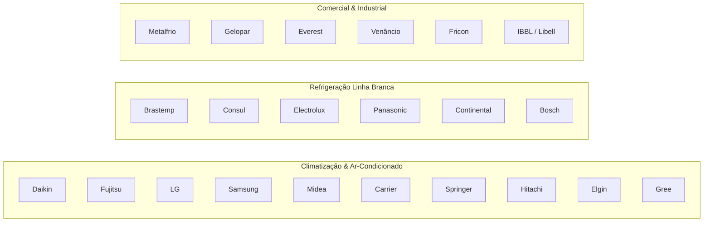

# Especificação de Arquitetura Visual Enxuta, Eliminação de Textos Duplicados e Vitrine Multimarcas

> Versão: 1.0 (2026-11-07)  
> Fase: 08 — Unificação Visual do Navbar, Conteúdo Único Sem Repetição e Vitrine Multimarcas  
> Status: Aprovado para Engenharia (Task T08.01)

---

## 1. Motivação e Diagnóstico da Demanda do Usuário

1. **Incompatibilidade Visual do Navbar com Rotas Antigas:**  
   - O `NavbarComponent` adota um estilo transparente com logotipo branco e itens de menu claros quando o scroll da página está no topo (`scrolled = false`).  
   - A página `/contato` possuía `
`, fazendo com que o navbar transparente ficasse invisível (texto branco sobre fundo branco).  
   - A rota `/servicos` ainda executava o carrossel legado `ngx-slick-carousel` com cards que não dialogavam com o design moderno das páginas de detalhe (`service-detail`) e FAQ (`faq-areas`).  
   - A rota `/sobre` mantinha cards legados sem o padrão de hero escuro.
2. **Excesso de Texto Corrido e Repetição Enfadonha:**  
   - Frases inteiras ("garantia formal de 90 dias", "técnicos certificados e treinados", "peças originais", "orçamento sem compromisso") eram repetidas 3 a 5 vezes na mesma página (Home) e duplicadas em `/sobre` e `/servicos`.  
   - A Home possuía blocos pesados de texto ("Como Funciona o Atendimento em 4 Passos" e "Por Que Confiar na Alves Refrigeração"), tornando a leitura cansativa para usuários móveis que buscam rapidez.
3. **Ausência de Vitrine Visual de Marcas de Refrigeração:**  
   - Faltava uma vitrine visual de marcas comerciais e domésticas de refrigeração (Metalfrio, Gelopar, Everest, Venâncio, Brastemp, Consul, Electrolux) combinada com as marcas consagradas de ar-condicionado (Daikin, Fujitsu, LG, Samsung, Midea, Carrier, Springer, Hitachi).  
   - Havia mais de 15 imagens WebP reais de alta qualidade em `src/assets/img/` subutilizadas na Home.

---

## 2. Princípio da Unicidade de Conteúdo (Zero Repetição)

Para tornar cada página do site atraente, dinâmica e exclusiva, fica estabelecida a matriz de exclusividade funcional e textual:

| Bloco Funcional / Tema | Página Exclusiva | Regra de Eliminação nas Demais Páginas |
| :--- | :--- | :--- |
| **Mascote Animado + Hero de Impacto** | **Home (`/`)** | Proibido usar o mascote em outras páginas para preservar a identidade da capa. |
| **Vitrine Visual com Fotos Reais dos 4 Reparos** | **Home (`/`)** | Frases ultracurtas (≤ 12 palavras) com fotos reais WebP. |
| **Mural Multimarcas & Equipamentos** | **Home (`/`)** | Mistura rica de marcas de climatização + refrigeração doméstica e comercial. |
| **Prova Social Google 5.0★ (`<app-reviews-carousel>`)** | **Home (`/`)** | O carrossel de avaliações fica fixo na Home. Removido de `/sobre` para não duplicar. |
| **Fluxo do Atendimento em 4 Passos** | **`/servicos`** | **Removido totalmente da Home.** Fica exclusivo da página de Serviços como guia do cliente. |
| **Galeria Técnica Completa de Serviços (6 cards com fotos reais)** | **`/servicos`** | Exclusivo de `/servicos`. |
| **História, Missão, Visão e Valores (MVV) com Fotos Reais** | **`/sobre`** | Exclusivo de `/sobre` (`boas-praticas-refrigeracao.webp` e `missao_visao_valores.webp`). |
| **Formulário de Contato, Canais Rápidos e Google Maps** | **`/contato`** | Exclusivo de `/contato` com Hero escuro padronizado. |

---

## 3. Especificação Detalhada por Rota

### 3.1. Home (`/`) — Foco Visual, Enxuto e Sem Repetições

A Home é reconstruída em **4 blocos estritamente visuais**, com zero blocos de texto longo:

#### Bloco 1: Hero de Impacto
- **Visual:** Fundo escuro azul-marinho com gradiente (`#071527` a `#0b2546`), partículas animadas, logotipo branco, mascote animado à direita com glow.
- **Copy Enxuta:**
  - Badge: `Assistência Técnica em Nova Lima & Grande BH`
  - Título H1: `Especialistas em Ar-Condicionado e Refrigeração`
  - Subtítulo (máximo 18 palavras): `Conserto rápido, manutenção preventiva e instalação com peças originais e garantia formal em Nova Lima.`
  - 4 Pílulas Visuais: `❄ Ar-Condicionado` | `❄ Geladeiras e Freezers` | `🍺 Chopeiras` | `💧 Bebedouros`
  - CTAs Diretos: Botão Dourado WhatsApp (`Solicitar Orçamento`) + Botão Outline Telefone (`(31) 99285-5049`).
  - Trust Bar (sem parágrafos): `✓ Garantia de 90 dias` | `✓ Atendimento Domiciliar` | `✓ Avaliação 5.0★ Google`.

#### Bloco 2: Vitrine Visual de Especialidades (Fotos Reais)
Substitui os antigos cards de texto corrido por uma grade visual de 4 cards modernos contendo imagens reais em WebP e frases curtas (máximo 12 palavras):
1. **Instalação & Splits:** Imagem `ConcertoArcond.webp`  
   *Legenda:* "Instalação técnica padrão de splits, multi-splits e modelos inverter."  
   *Link:* `/servicos/instalacao-ar-condicionado`
2. **Geladeiras & Freezers:** Imagem `ConcertoGeladeira.webp`  
   *Legenda:* "Conserto rápido de geladeiras Frost-Free, troca de compressores e carga de fluido."  
   *Link:* `/servicos/conserto-geladeira-freezer`
3. **Chopeiras & Bebedouros:** Imagem `ConcertoBebedouro.webp`  
   *Legenda:* "Manutenção de chopeiras elétricas e a gelo, sanitização e bebedouros industriais."  
   *Link:* `/servicos/chopeiras-bebedouros`
4. **Manutenção & Placas Eletrônicas:** Imagem `troca-placa.webp`  
   *Legenda:* "Reparo de placas inversoras, sensores térmicos e higienização profunda bactericida."  
   *Link:* `/servicos/manutencao-ar-condicionado`

#### Bloco 3: Mural Multimarcas & Equipamentos de Refrigeração
Apresenta de forma moderna a ampla variedade de marcas atendidas, divididas em categorias claras e intercaladas com mini-galeria de serviços em execução:
- **Segmento Climatização (Splits, Inverters e Cassetes):**  
  `Daikin` • `Fujitsu` • `LG` • `Samsung` • `Midea` • `Carrier` • `Springer` • `Hitachi` • `Elgin` • `Gree`
- **Segmento Linha Branca Residencial:**  
  `Brastemp` • `Consul` • `Electrolux` • `Panasonic` • `Continental` • `Bosch`
- **Segmento Comercial & Industrial:**  
  `Metalfrio` • `Gelopar` • `Everest` • `Venâncio` • `Fricon` • `Ibbl` • `Bebedouros Libell`
- **Mosaico Visual de Oficina e Reparos:**  
  Imagens reais com badges de ação:
  - `troca_compressor.webp`: "Substituição de Compressores"
  - `recarga-fluido.webp`: "Recarga com Fluido Ecológico (R-32 / R-410A)"
  - `manutencao-preventiva.webp`: "Higienização e Teste de Estanqueidade"
  - `limpeza-geladeiras.webp`: "Manutenção Térmica Preventiva"

#### Bloco 4: Prova Social Google 5.0★ + Chamado Rápido
- Componente `<app-reviews-carousel></app-reviews-carousel>` exibindo os depoimentos reais de clientes de Nova Lima.
- Faixa compacta de conversão: *"Precisa de assistência técnica hoje em Nova Lima ou região?"* com botões de WhatsApp e Telefone.
- *(Nota de eliminação: Os blocos de texto repetitivo "Como funciona o atendimento em 4 passos" e "Por que confiar com 4 parágrafos" são removidos definitivamente da Home).*

---

### 3.2. Página `/servicos` — Catálogo Visual Técnico

- **Hero Escuro Unificado:** Fundo dark moderno garantindo visibilidade total do Navbar transparente com título H1: `Nossos Serviços de Climatização e Refrigeração`.
- **Subtítulo:** `Assistência técnica especializada multimarcas em Nova Lima, Alphaville e Grande BH.`
- **Galeria Visual de 6 Serviços (Cards Ricos com Fotos Reais):**
  1. *Instalação de Ar-Condicionado* (`ConcertoArcond.webp` | Link: `/servicos/instalacao-ar-condicionado`)
  2. *Manutenção Preventiva & Higienização* (`manutencao-preventiva.webp` | Link: `/servicos/manutencao-ar-condicionado`)
  3. *Recarga de Gás e Teste de Vazamentos* (`recarga-fluido.webp` | Link: `/servicos/manutencao-ar-condicionado`)
  4. *Reparo de Placas e Compressores* (`troca-placa.webp` | Link: `/servicos/conserto-geladeira-freezer`)
  5. *Conserto de Geladeiras e Freezers* (`ConcertoGeladeira.webp` | Link: `/servicos/conserto-geladeira-freezer`)
  6. *Chopeiras Comerciais e Bebedouros* (`ConcertoBebedouro.webp` | Link: `/servicos/chopeiras-bebedouros`)
- **Fluxo do Atendimento em 4 Passos (Exclusivo desta página!):**
  - Passo 1: `Contato via WhatsApp` (sintoma e modelo)
  - Passo 2: `Agendamento Rápido` (visita técnica no local)
  - Passo 3: `Diagnóstico e Reparo` (peças originais)
  - Passo 4: `Entrega com Garantia` (termo formal de 90 dias)
- **Eliminação do `ngx-slick-carousel` legado:** Substituição por CSS Grid responsivo com efeito hover, imagens nítidas em WebP e links funcionais diretos para as páginas de detalhe.

---

### 3.3. Página `/sobre` — Quem Somos & Credenciais da Empresa

- **Hero Escuro Unificado:** Fundo dark azul escuro, garantindo compatibilidade com o Navbar transparente.
- **Título H1:** `Sobre a Alves Refrigeração em Nova Lima`
- **Subtítulo:** `Compromisso com honestidade técnica, pontualidade e excelência em cada atendimento.`
- **Bloco Institucional com Fotos Reais:**
  - Imagem `boas-praticas-refrigeracao.webp` com selo "Boas Práticas de Refrigeração e Segurança".
  - Imagem `missao_visao_valores.webp` ilustrando os pilares de Missão, Visão e Valores.
- **Métricas Objetivas:**
  - `90 Dias`: Garantia formal em serviços e peças.
  - `Multimarcas`: Atendimento qualificado às principais marcas nacionais e importadas.
  - `Nova Lima e Região`: Sede física própria na Rua Professora Anésia de Matos Guimarães, 80 B.
  - `100%`: Transparência em orçamentos antes da execução.
- **Eliminação de Repetições:** Removida a cópia do carrossel de avaliações que já existe na Home.

---

### 3.4. Página `/contato` — Canais Rápidos, Formulário Moderno e Mapa

- **Hero Escuro Unificado (Correção Crítica do Navbar!):**
  - Substituição da antiga `
` por um Hero escuro no topo da página.
  - O Navbar transparente permanece 100% visível, com contraste perfeito de textos e logo branca.
- **Título H1:** `Fale com a Alves Refrigeração`
- **Subtítulo:** `Atendimento ágil em domicílio em Nova Lima, Alphaville, Vila da Serra e Grande BH.`
- **Bloco de Ação Imediata (3 Cards Rápidos de Contato):**
  - Card 1: **WhatsApp Oficial:** `(31) 99285-5049` (Abertura de conversa em 1 clique).
  - Card 2: **Telefone Direto:** `(31) 99285-5049` (Ligação imediata `tel:`).
  - Card 3: **Endereço Sede:** `Rua Professora Anésia de Matos Guimarães, 80 B - Vila Padre Valeriano, Nova Lima/MG`.
- **Formulário Moderno Integrado com WhatsApp:**  
  - Campos: Nome, Telefone, Serviço Desejado (select), Bairro/Cidade e Mensagem.  
  - Ao clicar em "Enviar Mensagem", valida os campos e abre o WhatsApp com a mensagem pré-formatada.
- **Mapa Interativo Google Maps:**  
  - Iframe responsivo com coordenadas homologadas de Nova Lima e botão "Abrir no Google Maps".

---

## 4. Catálogo Oficial Multimarcas (Matriz de Referência)

---

## 5. Critérios de Aceite Testáveis da Fase 08

- [ ] **CA-08.01 (Unificação Visual do Navbar nas Rotas):** As rotas `/`, `/servicos`, `/sobre` e `/contato` devem possuir Hero escuro inicial com fundo escuro (`#071527` ou similar), garantindo contraste imediato e legibilidade perfeita da logo branca e itens de menu do `NavbarComponent` no topo da tela sem necessidade de scroll.
- [ ] **CA-08.02 (Redução Drástica de Texto Corrido na Home):** A Home (`/`) deve conter apenas textos ultracurtos e diretos: legendas de especialidades com no máximo 12 palavras, remoção de parágrafos extensos e ausência de blocos textuais repetitivos.
- [ ] **CA-08.03 (Zero Repetição de Blocos entre Páginas):**  
  - O fluxo "Como Funciona o Atendimento em 4 Passos" deve estar presente exclusivamente em `/servicos` e ausente da Home.  
  - O carrossel de avaliações Google deve residir na Home e ser removido de `/sobre`.  
  - Os blocos institucionais de MVV com fotos reais devem residir exclusivamente em `/sobre`.
- [ ] **CA-08.04 (Vitrine Visual Multimarcas de Refrigeração e Climatização):** A Home e as páginas de serviços devem exibir a matriz multimarcas contemplando explicitamente marcas de ar-condicionado (Daikin, LG, Samsung, Midea, Carrier, Fujitsu, Springer, Hitachi) e marcas de refrigeração doméstica/comercial (Brastemp, Consul, Electrolux, Panasonic, Metalfrio, Gelopar, Everest, Venâncio), integrada a fotos reais WebP.
- [ ] **CA-08.05 (Responsividade e Qualidade de Links):** Todos os cards de serviços em `/servicos` e na Home devem apontar para as respectivas URLs canônicas (`/servicos/:slug`, `/contato`, `/perguntas-frequentes`), sem erros 404, sem páginas em branco e com botões de WhatsApp devidamente codificados.
- [ ] **CA-08.06 (Pipeline de Qualidade 100% Verde):** A compilação `npm run build`, a suíte de testes `npm run test:ci` (ou `npm test -- --watch=false`) e a auditoria de SEO `npm run seo:audit` devem passar com 100% de aprovação sem regressões.
